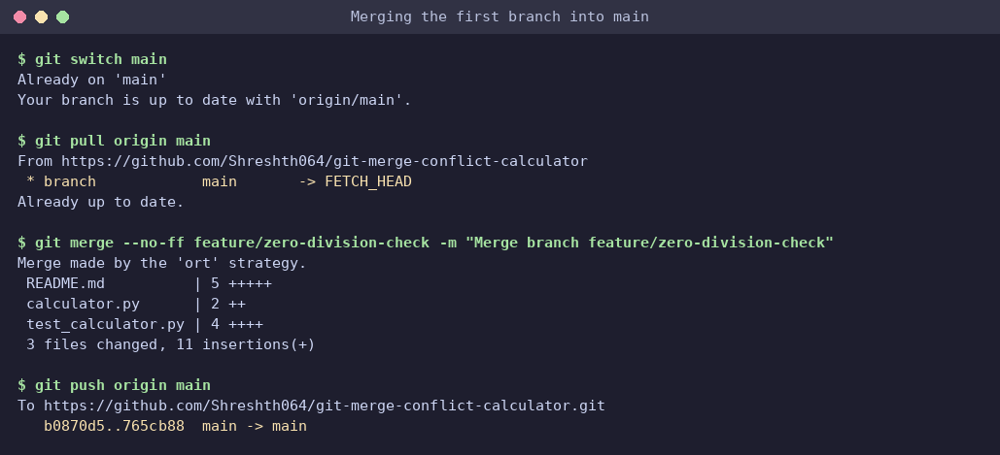
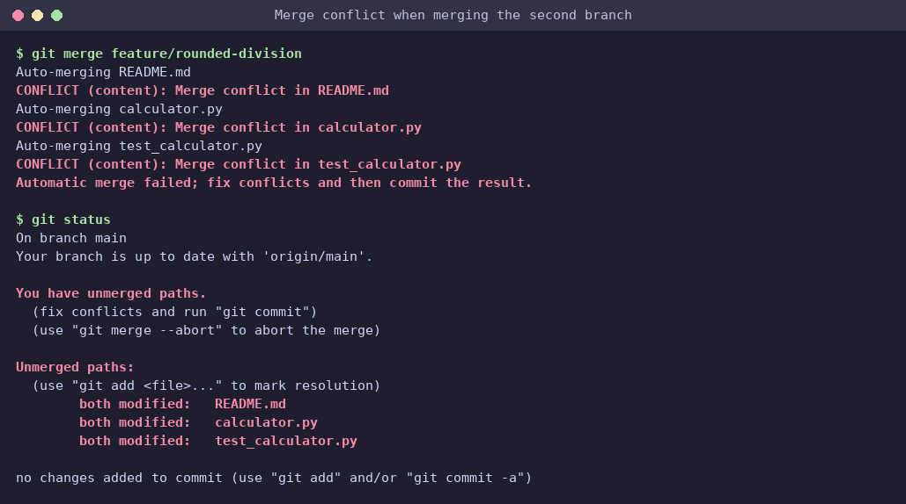
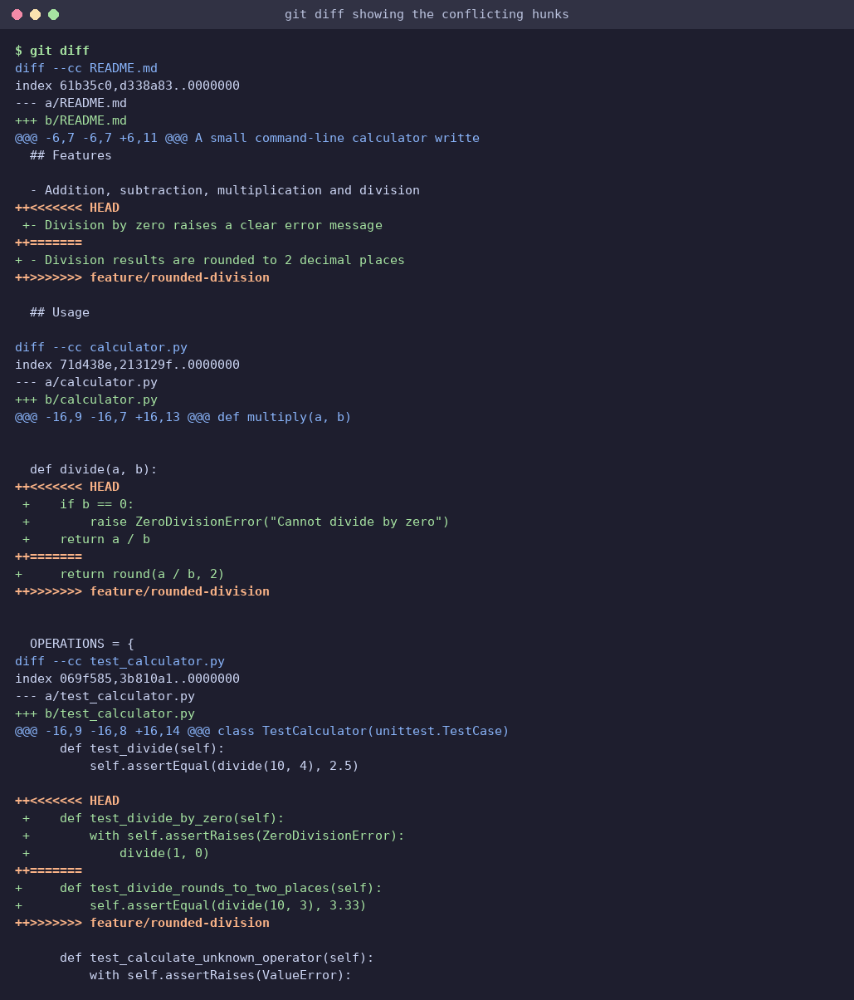
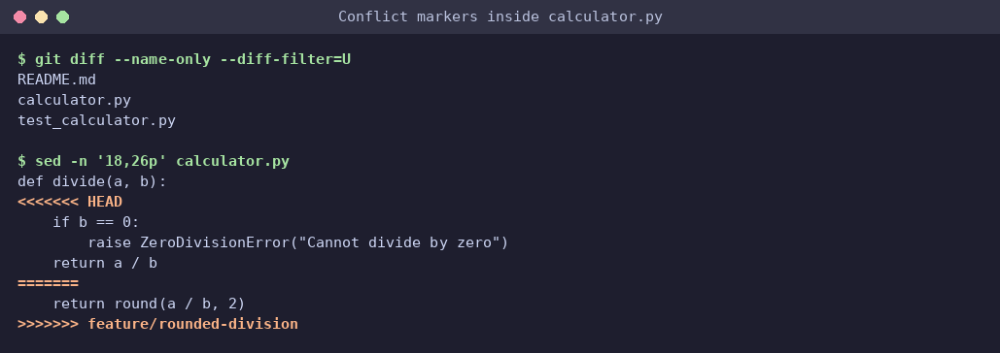
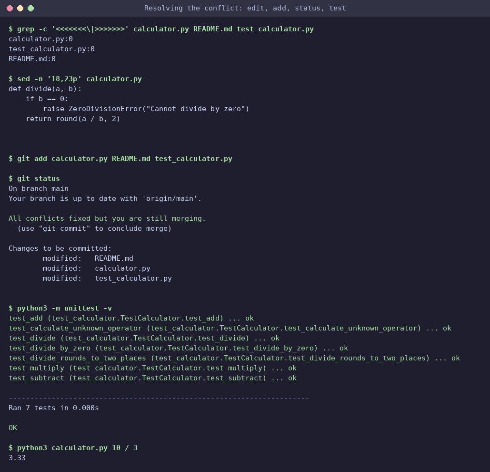
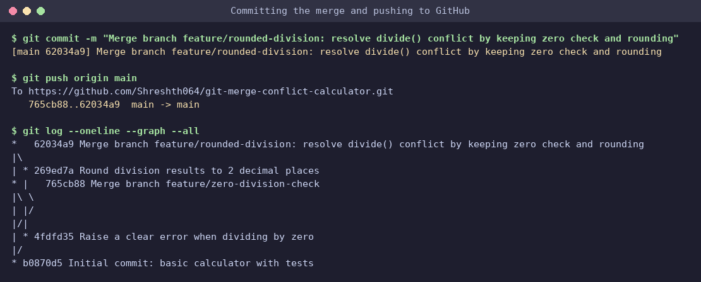
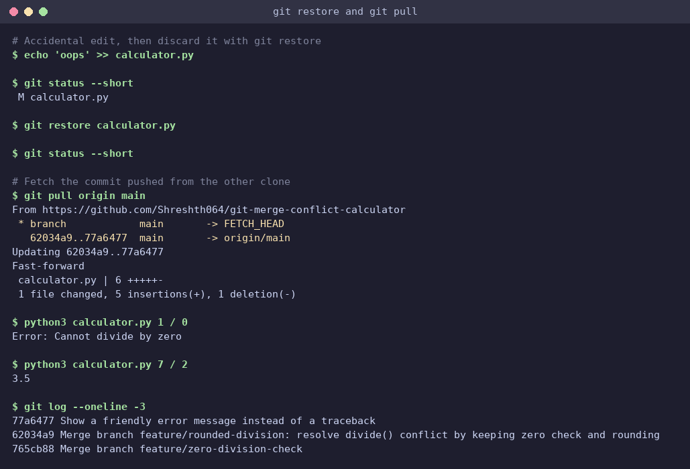

# Merge Conflict: Exact Steps Taken

Repository: https://github.com/Shreshth064/git-merge-conflict-calculator

## 1. Set up the repository and connect it to GitHub

```bash
git init -b main
git add .
git commit -m "Initial commit: basic calculator with tests"
gh repo create git-merge-conflict-calculator --public --source=. --remote=origin --push
#   (same as: git remote add origin https://github.com/Shreshth064/git-merge-conflict-calculator.git
#             git push -u origin main)
```

## 2. Create two branches that change the same lines

Both branches started from the initial commit `b0870d5` and both changed the body of
`divide()` in `calculator.py`, the same line under "Features" in `README.md`, and the same
spot in `test_calculator.py`.

```bash
# Branch 1: raise an error when dividing by zero
git switch -c feature/zero-division-check
#   edit divide():  if b == 0: raise ZeroDivisionError("Cannot divide by zero")
git add -A
git commit -m "Raise a clear error when dividing by zero"
git push -u origin feature/zero-division-check

# Branch 2: round division results
git switch main
git switch -c feature/rounded-division
#   edit divide():  return round(a / b, 2)
git add -A
git commit -m "Round division results to 2 decimal places"
git push -u origin feature/rounded-division
```

## 3. Merge the first branch (clean merge)

```bash
git switch main
git pull origin main
git merge --no-ff feature/zero-division-check -m "Merge branch feature/zero-division-check"
git push origin main
```



## 4. Merge the second branch (conflict)

```bash
git merge feature/rounded-division
git status
```

Git reported `CONFLICT (content)` in all three files and listed them as **both modified**.



## 5. Look at the conflict

```bash
git diff                              # combined diff: both sides of each conflict
git diff --name-only --diff-filter=U  # only the unmerged files
```



Inside `calculator.py` Git wrote conflict markers:

```text
def divide(a, b):
<<<<<<< HEAD
    if b == 0:
        raise ZeroDivisionError("Cannot divide by zero")
    return a / b
=======
    return round(a / b, 2)
>>>>>>> feature/rounded-division
```



## 6. Resolve by hand

Both changes were useful, so I kept both: check for zero first, then round the result.
I removed the `<<<<<<<`, `=======` and `>>>>>>>` lines and wrote:

```python
def divide(a, b):
    if b == 0:
        raise ZeroDivisionError("Cannot divide by zero")
    return round(a / b, 2)
```

I did the same in `README.md` (kept both feature lines) and `test_calculator.py` (kept both
tests). Then:

```bash
grep -c '<<<<<<<\|>>>>>>>' calculator.py README.md test_calculator.py   # check: 0 markers left
git add calculator.py README.md test_calculator.py                      # mark as resolved
git status                                                               # "All conflicts fixed but you are still merging"
python3 -m unittest -v                                                   # all 7 tests pass
```



## 7. Finish the merge and push

```bash
git commit -m "Merge branch feature/rounded-division: resolve divide() conflict by keeping zero check and rounding"
git push origin main
git log --oneline --graph --all
```



## 8. `git restore` and `git pull`

To act like a second developer, I cloned the repository into another folder, changed `main()`
to print a friendly error message, and pushed. Back in the original repository:

```bash
echo 'oops' >> calculator.py   # accidental edit
git restore calculator.py      # discard it and return to the last commit
git pull origin main           # bring in the commit pushed from the other clone
```



## Other commands that would also work

- `git merge --abort`: cancels the merge and puts `main` back as it was before.
- `git restore --source=HEAD calculator.py` / `git checkout --ours calculator.py`: keep main's version.
- `git checkout --theirs calculator.py`: keep the incoming branch's version.
- `git rebase main` on the feature branch: replays its commit on top of the updated `main`, so
  you fix the conflict on the branch before merging.
